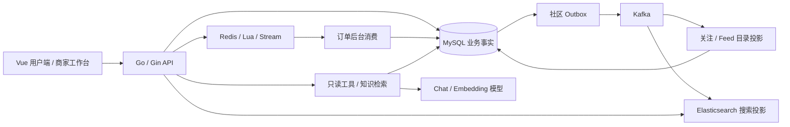

# project-full-stack · 本地生活交易平台

Go + Vue 本地生活平台。商家发券，顾客抢券并查询成单结果，店员在授权门店核销。顾客还可以发布探店笔记、看关注动态和搜索公开内容。支付与退款使用模拟资金，业务 AI 提供带来源的只读查询。

[项目展示](https://tech-cove01.github.io/project-full-stack/) · [打开演示台](https://tech-cove01.github.io/project-full-stack/workspace/) · [技术详解](https://tech-cove01.github.io/project-full-stack/details.html)

## 项目亮点

### 交易受理与可靠成单

抢券响应超时后，顾客可重试同一请求。已受理的请求会返回原受理 ID，重试不会多建订单。页面分开显示受理和成单状态，顾客可凭受理 ID 继续查询。取消后重新购买，旧补偿只处理原来的预占，新的购买资格和库存预占仍然有效。

Redis Lua 原子校验活动与资格、预占库存、保存受理 ID，并向 Redis Stream 投递成单消息。后台在 MySQL 事务中成单，以唯一约束和幂等检查防止重复写入。订单结果或待核对记录持久化后才确认消息（ACK）。补偿处理时核对原受理、订单和预占归属。

### Feed 缓存与并发回源

多人浏览关注动态时可以复用公共正文，各自的点赞状态独立显示。相同内容正在加载时，一个请求取消等待，其余请求仍可继续。

公共正文按笔记 ID 和发布版本写入进程内缓存与 Redis，个人点赞和当前可见性单独读取。公共正文缺失时批量回源，同一进程合并相同的缺失批次，并限制并发回源数。

### 事件投递与 ES 搜索

搜索索引随笔记变更异步更新。即使索引更新有延迟，搜索也会过滤已隐藏或版本过期的内容。同步失败时会保存记录，连接恢复后可人工重放。

笔记变更与 Outbox 在同一 MySQL 事务内提交，经 Kafka 更新 Elasticsearch 索引。消费收据用于去重，业务版本用于防止旧事件覆盖新状态。返回搜索结果前向 MySQL 核对候选的当前公开状态和业务版本。

### 点赞链路与下游处理

顾客点赞或取消后可读取已提交的状态和计数，重试相同状态不会重复计数。后续事件的发布与消费都有记录，可以对账。

MySQL 在同一事务中提交点赞关系、计数和 Outbox。已有点赞关系切换状态时，用合并后的 SQL 更新关系与计数。启用批处理时，发布端按条数和字节数限制批次，消费端批量保存符合条件的点赞事件收据，减少数据库往返和事务提交。Kafka 承接后续投影。

## 核心功能

| 模块 | 功能 |
| --- | --- |
| 用户与商铺 | 登录、身份恢复与退出，商铺搜索、分类、分页、详情及公开优惠 |
| 活动与订单 | 活动发布与下架、异步抢券成单、模拟支付、取消、超时关闭、核销和退款 |
| 商家工作台 | OWNER / MANAGER / STAFF 逐门店授权，管理活动与订单，查询核销、退款和操作审计 |
| 探店社区 | 发布笔记、点赞与取消、关注关系、复合游标分页的关注动态 |
| 全文搜索 | 公开笔记标题与正文检索、门店筛选、确定排序和分页 |
| 业务 AI | 查询公开规则与本人订单、活动库存和门店信息，展示可点击来源与只读工具卡片 |

## 技术栈

| 层次 | 技术与用途 |
| --- | --- |
| 前端 | Vue 3、TypeScript、Vite、Vue Router、Pinia、Element Plus |
| 后端 | Go 1.27、Gin、GORM、go-redis/v9 |
| 数据与缓存 | MySQL 8.4、Redis 7.4、有界进程内缓存（L1）、批量装配与回源合并 |
| 交易任务 | Redis Lua、Redis Stream、MySQL 事务、订单幂等与补偿 |
| 事件投影 | 事务 Outbox、Kafka、独立消费组、事件去重与业务版本校验 |
| 全文搜索 | Elasticsearch、CJK 分词、PIT / search_after、MySQL 事实复核 |
| 业务 AI | Go net/http 兼容 Chat / Embedding、百炼 Qwen、MySQL 知识持久化与小规模精确向量检索、应用层 SSE |
| 工程工具 | Docker Compose、版本化 SQL 迁移、go test / httptest、k6、GitHub Actions |

## 补充设计

### 逐门店权限与交易审计

用户端与商家端共享同一套交易事实。OWNER / MANAGER / STAFF 的操作范围由商家成员关系与门店授权共同决定。核销和退款在业务事务内再次检查并锁定当前授权，订单状态与审计记录共同提交，使撤权、重复操作和并发状态变化都有明确处理边界。

### 带来源的只读业务 AI

知识问答检索已发布 FAQ，保留来源、分块和索引版本；本人订单、活动库存与门店数据由服务端只读工具查询。会话归属、当前身份与知识版本在关键阶段复核，应用通过 SSE 展示进度、来源、工具结果和答案，支持取消与消息去重，衔接到实际业务页面。

### Vue 全栈交互与模块化单体

Vue 3 / TypeScript 工作台承接用户交易、社区搜索和商家核销退款，Pinia 管理身份与页面状态，Element Plus 提供表单和列表交互。Go 后端按交易、商家、社区、搜索和 AI 划分模块，统一组装 HTTP 路由、连接池与后台任务，并随进程生命周期管理消费和关闭。

## 系统架构



后端采用模块化单体。订单使用 Redis Stream 异步成单，交易 Outbox 驱动补偿；社区 Outbox 经 Kafka 更新查询投影。MySQL 保存最终业务事实，Redis 和 ES 承担可恢复的缓存与查询职责。

## 本地运行

环境要求：**Go 1.27、Node.js 22.12+、npm、Docker Compose**。基础依赖为 MySQL 与 Redis；Kafka、Elasticsearch 和模型服务按所选功能配置。

- [本地环境、数据库迁移与 Go 启动](docs/development.md#go-迁移环境与启动)
- [用户、商家与业务 AI 演示](docs/demo-recording.md)
- [核心源码与设计取舍](docs/source-walkthrough.md)

## 目录

```text
backend/          Go API、业务模块与后台任务
frontend/         Vue 用户端与商家工作台
infra/mysql/      表结构、演示数据与版本迁移
scripts/          启动辅助、业务验证与量化工具
docs/             架构、运行说明与开发记录
archive/          冻结参考源码、旧构建与历史文档
compose.go.yaml   本地 MySQL / Redis 及可选 Kafka / ES
```

阅读源码可从[后端模块导航](backend/README.md)与[前端页面导航](frontend/README.md)开始。

## 许可证

项目原创内容采用 [MIT License](LICENSE)。复用来源及适用范围见 [第三方来源说明](THIRD_PARTY_NOTICES.md)。
