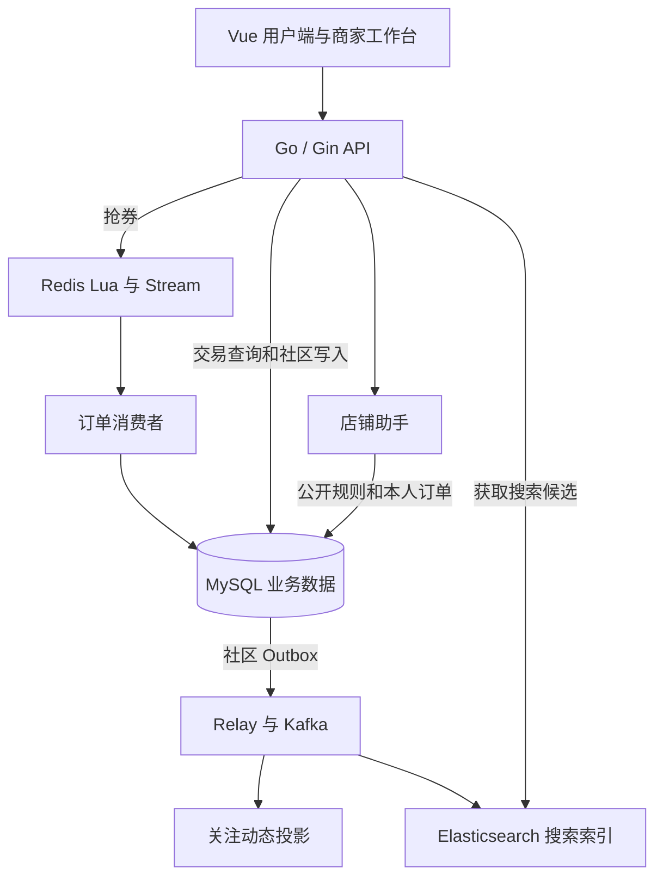

# Full Stack · 本地生活交易平台

面向顾客和门店的 Go + Vue 全栈应用。店主发布到店优惠，顾客找店、抢券并模拟支付，授权店员凭码核销。探店社区支持发布笔记、关注、点赞与全文搜索，店铺助手可以查询公开规则和本人订单。

**[打开在线产品演示](https://tech-cove01.github.io/project-full-stack/product/#/)** · [项目主页](https://tech-cove01.github.io/project-full-stack/)

在线演示使用浏览器内的示例数据。真实应用的运行方式见[本地启动](#本地启动)。

## 一笔到店交易

街角咖啡有一张售价 ¥19、面值 ¥30 的到店券。演示里可以切换顾客、店员和店主，查看同一笔订单在三个页面上的状态。

- **抢券与查单。** 顾客抢券后先在订单页看到受理进度，成单后进入待支付。
- **支付与核销。** 顾客模拟支付后取得核销凭证。店员在有权限的门店用凭证完成核销。
- **订单回查。** 顾客在「我的订单」确认同一笔订单已核销，店主可在商家工作台查看订单和操作记录。

[从街角咖啡开始体验](https://tech-cove01.github.io/project-full-stack/product/#/shops/1)

## 功能亮点

| 能力 | 技术细节 |
| --- | --- |
| **抢券受理与幂等成单** | Redis Lua 原子校验活动、限购与库存，预占库存并写入 Redis Stream。重试时沿用仍有效的原受理编号。Go 消费者依靠 MySQL 事务与唯一约束幂等成单，结果或待核对记录持久化后才确认消息。库存补偿按事件去重，取消释放购买资格前检查原订单归属。 |
| **点赞写入与事件批处理** | MySQL 在同一事务内更新点赞关系和计数，并追加 Outbox 事件。重复设置同一状态不会重复计数，已有关系切换时用一条 SQL 更新关系和计数。Outbox 可按条数和字节数分批投递，符合条件的点赞消费收据可批量持久化。 |
| **关注动态与缓存回源** | 按「发布时间 + 笔记 ID」使用游标分页。公共正文按笔记 ID 和发布版本缓存到进程内和 Redis，查询时用 MySQL 核对关注关系和笔记可见性，并批量读取个人点赞状态。同一进程内相同的缺失批次合并回源，并限制回源并发。 |
| **笔记发布与全文搜索** | 发布笔记和写入 Outbox 在同一 MySQL 事务内进行。Kafka 消费者按业务版本写入 Elasticsearch，成功后记录消费收据，已留档的失败事件可重放。搜索结果返回前向 MySQL 核对笔记仍公开且版本一致。 |

## 系统架构



Go 后端采用模块化单体。交易用 Redis Stream 异步成单，交易 Outbox 驱动库存补偿。社区通过独立 Outbox 和 Kafka 更新关注动态与搜索索引。店铺助手通过 SSE 返回回答、规则出处或只读订单卡片。

[在项目主页查看交易、社区和店铺助手架构](https://tech-cove01.github.io/project-full-stack/#architecture)

## 技术栈

| 层次 | 技术 |
| --- | --- |
| Web 与交互 | Vue 3、TypeScript、Vite、Vue Router、Pinia、Element Plus |
| API、数据与交易 | Go 1.27、Gin、GORM、MySQL 8.4、Redis 7.4、Lua、Redis Stream |
| 社区与搜索 | 事务 Outbox、Kafka、Elasticsearch、CJK 分词、PIT / search_after |
| 店铺助手 | Chat / Embedding 接口、百炼 Qwen、MySQL 知识检索、SSE |
| 开发与验证 | Docker Compose、版本化 SQL 迁移、go test、httptest |

## 本地启动

需要 **Go 1.27、Node.js 22.12+、npm、Docker Compose 和 MySQL 客户端**。先按[开发指南](docs/development.md#go-迁移环境与启动)配置终端中的 MySQL 和 Redis 连接。在同一终端中，从仓库根目录启动基础依赖、应用迁移和运行 API。

```powershell
docker compose -f compose.go.yaml up -d --wait mysql redis
node scripts/migrate.mjs
go -C backend run ./cmd/api
```

另开一个终端，在仓库根目录启动前端。

```powershell
npm.cmd --prefix frontend ci
npm.cmd --prefix frontend run dev -- --port 5174 --strictPort
```

访问 [本地 Web 应用](http://127.0.0.1:5174/)。前端默认代理至 `127.0.0.1:8082`。社区投影、全文搜索和店铺助手按需配置，完成角色与券的演示可参考[本机演示手册](docs/demo-recording.md)。

## 仓库结构

```text
backend/cmd/       Go API 与后台维护命令
backend/internal/  交易、商家、社区、搜索与助手模块
frontend/src/      Vue 用户端与商家工作台
infra/mysql/       数据库结构、示例数据与版本迁移
showcase/          项目介绍站与在线演示
docs/              产品设计与本地运行指南
```

## 许可证

[MIT License](LICENSE) · [第三方声明](THIRD_PARTY_NOTICES.md)
