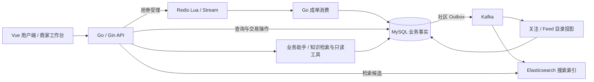

# Full Stack · 本地生活交易平台

面向顾客与门店的 Go + Vue 全栈应用。商家发布优惠券，顾客抢券、查单、模拟支付，授权店员完成核销。顾客还可以发布探店笔记、浏览关注动态并搜索公开内容。

**[打开在线演示台](https://tech-cove01.github.io/project-full-stack/workspace/)** · [项目主页与架构](https://tech-cove01.github.io/project-full-stack/) · [业务与技术详解](https://tech-cove01.github.io/project-full-stack/details.html)

在线演示使用浏览器内的示例数据，无需登录。真实应用见[本地运行](#本地运行)。

## 一笔到店交易

街角咖啡梧桐路店已发布一张 ¥19 购 ¥30 的到店券。打开演示台，可以顺着同一笔订单走完下面三步。

1. **抢券与查单。** 提交请求后先看到受理编号和库存预占。查询成单结果后，才出现一笔待支付订单。
2. **模拟支付与到店核销。** 顾客支付后取得示例凭证，授权店员核销。交易回执显示同一笔订单已核销。
3. **重复请求核对。** 完成后点击「重试同一请求」，受理编号、订单号和剩余库存保持一致。

## 项目亮点

| 能力 | 业务规则与实现 |
| --- | --- |
| [抢券重试与可靠成单](https://tech-cove01.github.io/project-full-stack/details.html#trade) | Redis Lua 原子校验资格、预占库存、保存受理编号并投递 Redis Stream。Go 消费任务在 MySQL 事务内幂等成单，订单结果或待核对记录持久化后才确认消息。取消后重买时，延迟补偿只处理原预占。 |
| [Feed 正文复用与并发回源](https://tech-cove01.github.io/project-full-stack/details.html#feed) | 公共笔记正文按 ID 和发布版本缓存到进程内与 Redis，当前可见性和个人点赞单独核对。缺失时批量回源，同一进程合并相同的缺失批次，并限制并发回源。 |
| [笔记事件与搜索一致性](https://tech-cove01.github.io/project-full-stack/details.html#events) | 笔记变更与 Outbox 同事务写入，经 Kafka 更新 Elasticsearch。消费收据用于去重，业务版本防止旧事件覆盖新状态。返回搜索结果前以 MySQL 复核公开状态与版本，失败事件可人工重放。 |
| [点赞写入与下游批处理](https://tech-cove01.github.io/project-full-stack/details.html#likes) | 点赞关系、计数与 Outbox 在同一 MySQL 事务提交。相同状态的重试无需重复计数，已有关系切换时合并 SQL。后续发布采用有界批次，消费端批量处理符合条件的点赞事件收据。 |

## 核心功能

| 模块 | 功能 |
| --- | --- |
| 用户与商铺 | 登录、分类与搜索、门店和优惠详情 |
| 交易与履约 | 活动发布与下架、抢券成单、模拟支付、取消与超时关闭、核销和模拟退款 |
| 商家工作台 | 店主、经理、店员按门店授权。核销与退款在事务内复核当前权限，订单状态和操作审计一起提交 |
| 探店社区 | 发布笔记、点赞与取消、关注作者、关注动态及复合游标分页 |
| 公开笔记搜索 | 检索标题与正文，支持门店筛选、排序和分页 |
| 业务助手 | 查询已发布门店规则、本人订单、活动库存和门店信息，返回可点击来源或只读业务卡片 |

## 系统架构



Go 后端采用模块化单体。订单由 Redis Stream 异步成单，交易 Outbox 驱动补偿。社区通过独立 Outbox 和 Kafka 更新 Feed 目录和搜索索引。MySQL 保存业务事实，查询结果可以回查当前状态。

[查看交互架构](https://tech-cove01.github.io/project-full-stack/details.html#architecture) · [查看订单状态](https://tech-cove01.github.io/project-full-stack/details.html#order-states) · [阅读源码路线](docs/source-walkthrough.md)

## 技术栈

| 层次 | 技术 |
| --- | --- |
| Web 与交互 | Vue 3、TypeScript、Vite、Vue Router、Pinia、Element Plus |
| API、数据与交易 | Go 1.27、Gin、GORM、MySQL 8.4、Redis 7.4、Lua、Redis Stream |
| 社区投影与检索 | 事务 Outbox、Kafka、Elasticsearch、CJK 分词、PIT / search_after |
| 知识问答 | Chat / Embedding 接口、百炼 Qwen、MySQL 知识检索、SSE |
| 工程验证 | Docker Compose、版本化 SQL 迁移、go test、httptest、k6、GitHub Actions |

## 本地运行

需要 **Go 1.27、Node.js 22.12+、npm、Docker Compose 和 MySQL 客户端**。先按[开发指南](docs/development.md#go-迁移环境与启动)配置数据库和服务环境变量，再在仓库根目录启动基础依赖并应用迁移。

```powershell
docker compose -f compose.go.yaml up -d --wait mysql redis
node scripts/migrate.mjs
```

在已配置连接环境的终端进入 `backend/`，运行 `go run ./cmd/api`。另开一个终端，从仓库根目录启动前端。

```powershell
npm.cmd --prefix frontend ci
npm.cmd --prefix frontend run dev -- --port 5174 --strictPort
```

访问 [本地 Web 应用](http://127.0.0.1:5174/)，前端默认代理到 `127.0.0.1:8082` 的 Go API。社区事件、全文搜索与业务助手的依赖配置见[开发指南](docs/development.md)。演练交易时可按[本机演示手册](docs/demo-recording.md)准备角色和新券。

## 目录

| 路径 | 内容 |
| --- | --- |
| [backend/](backend/README.md) | Go API、业务模块与后台任务 |
| [frontend/](frontend/README.md) | Vue 用户端和商家工作台 |
| [infra/mysql/](infra/mysql/) | 表结构、示例数据与版本迁移 |
| [showcase/](showcase/README.md) | GitHub Pages 展示站与在线演示 |
| [docs/](docs/) | 产品设计、源码说明和本地运行 |

## 许可证

项目原创内容采用 [MIT License](LICENSE)。复用素材和第三方代码见[第三方来源说明](THIRD_PARTY_NOTICES.md)。
