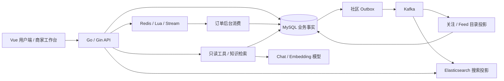

# project-full-stack · 本地生活交易平台

面向本地生活服务的全栈平台，连接用户消费、商家经营与探店分享。围绕活动发布、抢券、模拟支付、到店核销和退款构建交易流程，配套商家工作台、探店社区、全文搜索与带来源的业务 AI 助手。

后端采用 **Go、Gin 与 GORM**，前端采用 **Vue 3 与 TypeScript**。以 **MySQL** 保存业务事实，**Redis / Lua / Stream** 承担交易准入、异步成单与缓存，社区事件通过 **Outbox 与 Kafka** 驱动关注、Feed 目录和 **Elasticsearch** 搜索投影。

## 核心功能

| 模块 | 功能 |
| --- | --- |
| 用户与商铺 | 登录、身份恢复与退出，商铺搜索、分类、分页、详情及公开优惠 |
| 活动与订单 | 活动发布与下架、异步抢券成单、模拟支付、取消、超时关闭、核销和退款 |
| 商家工作台 | OWNER / MANAGER / STAFF 逐门店授权，管理活动与订单，查询核销、退款和操作审计 |
| 探店社区 | 发布笔记、点赞与取消、关注关系、复合游标分页的关注动态 |
| 全文搜索 | 公开笔记标题与正文检索、门店筛选、确定排序和分页 |
| 业务 AI | 查询公开规则与本人订单、活动库存和门店信息，展示可点击来源与只读工具卡片 |

支付与退款使用模拟资金流程；AI 工具只读，交易操作由业务接口处理。

## 技术栈

| 层次 | 技术与用途 |
| --- | --- |
| 前端 | Vue 3、TypeScript、Vite、Vue Router、Pinia、Element Plus |
| 后端 | Go 1.27、Gin、GORM、go-redis/v9 |
| 数据与缓存 | MySQL 8.4、Redis 7.4、有界 L1 缓存、批量装配与回源合并 |
| 交易任务 | Redis Lua、Redis Stream、MySQL 事务、订单幂等与补偿 |
| 事件投影 | 事务 Outbox、Kafka、独立消费组、事件去重与业务版本校验 |
| 全文搜索 | Elasticsearch、CJK 分词、PIT / search_after、MySQL 事实复核 |
| 业务 AI | Go net/http 兼容 Chat / Embedding、百炼 Qwen、MySQL 知识持久化与小规模精确向量检索、应用层 SSE |
| 工程工具 | Docker Compose、版本化 SQL 迁移、go test / httptest、k6、GitHub Actions |

## 项目亮点

### Lua 准入与异步幂等成单

Redis Lua 校验活动窗口、库存与用户资格，建立稳定受理映射并写入 Stream。后台消费者通过 MySQL 事务创建订单、审计和 Outbox，结合条件扣减与幂等检查处理重复消息；明确持久结果后确认消息，结果未知时保留待处理状态。取消、超时和拒绝通过补偿链路恢复对应预占，支持受控核对与重建。

### 逐门店权限与交易审计

用户端与商家端共享同一套交易事实。OWNER / MANAGER / STAFF 的操作范围由商家成员关系与门店授权共同决定，核销和退款在业务事务内再次检查并锁定当前授权，订单状态与审计记录共同提交，使撤权、重复操作和并发状态变化都有明确处理边界。

### Feed 分层缓存与批量回源

Feed 使用复合游标读取事实目录，公共正文按笔记 ID 和发布版本进入 L1 / Redis 缓存，缺失项批量查询并装配门店信息。相同缺失批次共享有界加载，公共计数单独缓存，个人点赞按当前身份查询；结合版本检查与失效代次处理旧回源竞争，避免把用户状态写入共享卡片。

### 可靠事件与可追溯搜索投影

笔记、点赞和关注的事实变更与社区 Outbox 在同一 MySQL 事务中提交。点赞采用期望状态写入，重复请求相同状态不重复计数；Kafka 独立消费组维护关注、Feed 目录与搜索投影，利用事件收据和业务版本处理重复、乱序，持久保存失败以供精确重放。ES 搜索候选再由 MySQL 核对当前公开状态与版本，保持索引与业务事实的职责边界。

### 带来源的只读业务 AI

知识问答检索已发布 FAQ，保留来源、分块和索引版本；本人订单、活动库存与门店数据由服务端只读工具查询。会话归属、当前身份与知识版本在关键阶段复核，应用通过 SSE 展示进度、来源、工具结果和答案，支持取消与消息去重，衔接到实际业务页面。

### Vue 全栈交互与模块化单体

Vue 3 / TypeScript 工作台承接用户交易、社区搜索和商家核销退款，Pinia 管理身份与页面状态，Element Plus 提供表单和列表交互。Go 后端按交易、商家、社区、搜索和 AI 划分模块，统一组装 HTTP 路由、连接池与后台任务，并随进程生命周期管理消费和关闭。

## 系统架构



后端采用模块化单体。订单使用 Redis Stream 异步成单，交易 Outbox 驱动补偿；社区 Outbox 经 Kafka 更新查询投影。MySQL 保存最终业务事实，Redis 和 ES 承担可恢复的缓存与查询职责。

## 本地运行

环境要求：**Go 1.27、Node.js 22.12+、npm、Docker Compose**。基础依赖为 MySQL 与 Redis；Kafka、Elasticsearch 和模型服务按所选功能配置。

- [本地环境、数据库迁移与 Go 启动](docs/development.md#go-迁移环境与启动)
- [用户、商家与业务 AI 演示](docs/demo-recording.md)
- [核心源码与设计取舍](docs/source-walkthrough.md)
- [开发状态与工作记录](STATUS.md)

## 目录

```text
backend/          Go API、业务模块与后台任务
frontend/         Vue 用户端与商家工作台
infra/mysql/      表结构、演示数据与版本迁移
scripts/          启动辅助、业务验证与量化工具
docs/             架构、运行说明与开发记录
compose.go.yaml   本地 MySQL / Redis 及可选 Kafka / ES
```

## 许可证

项目原创内容采用 [MIT License](LICENSE)。复用来源及适用范围见 [第三方来源说明](THIRD_PARTY_NOTICES.md)。
