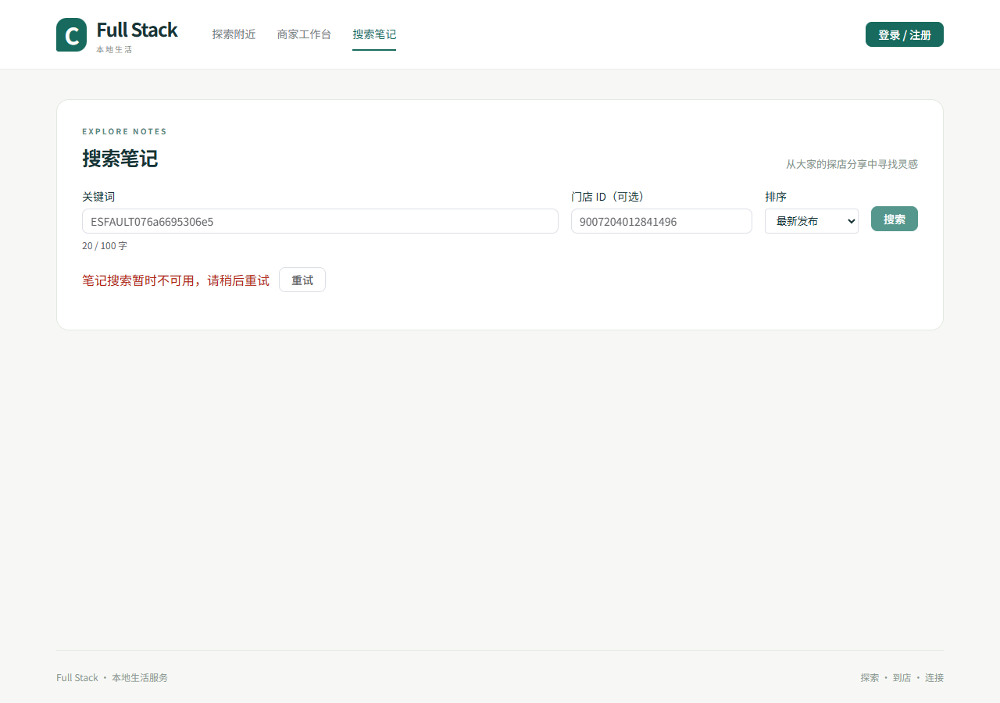
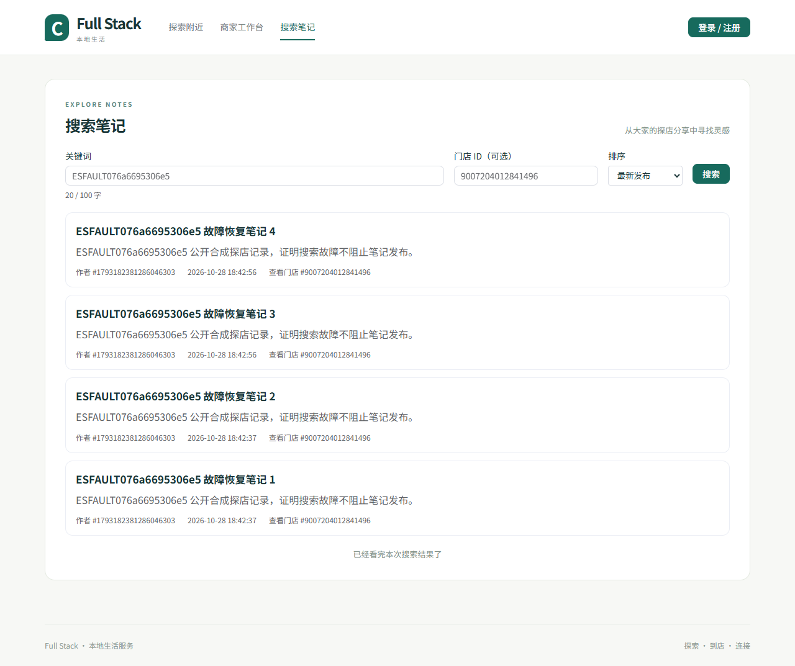

# GO-076c 物理 ES 停机、页面降级与恢复

实现者自测通过，待独立核验。脚本为 [go-note-search-fault.mjs](../../../../scripts/go-note-search-fault.mjs)，执行前固定 [计划](fault-plan.md)。本次没有 mock 响应、付费模型调用或其它项目资源操作。

## 实际结果

[原始结果](fault-initial/fault-result.json) **17 项通过**；[原始运行输出](fault-initial-run.txt) 保留。专用 API8086/Vue5176 持续运行，MySQL3332/Redis6404/Kafka9099 不停，实际仅停止并启动 `project-full-stack-go076-elasticsearch-1`。脚本先核对精确名称及 Compose 项目/服务标签，固定 loopback 端口，不能停止其它容器。

| 阶段 | 观察 |
| --- | --- |
| ES 正常 | 两次真实认证发布经 outbox/Kafka 后成为真实 Vue 搜索结果；三组提交位置均为 41，lag 0 |
| 物理 stop | Docker 状态 `running=false`、`OOMKilled=false`、exit **143**；这是本次 SIGTERM 后观察，不能写成 exit 0 |
| 真实页面故障 | 匿名浏览器实际收到 HTTP **503**，显示“笔记搜索暂时不可用，请稍后重试”与重试按钮；清空旧结果，没有用 LIKE 或假 JSON 冒充搜索 |
| 停机继续发布 | 又两次真实发布成功，四篇 MySQL 公开事实，四条 outbox `delivery_status='DONE'`；follow receipt 4（NOTE 对其为 IGNORED）、feed APPLIED 4、search APPLIED 2、PARKED 2 |
| 消费位置 | 三组均已提交到 43、log end 43、lag **0**；积压是 **2 条持久停车恢复记录**，不是未提交的 Kafka 消费积压 |
| 交易隔离 | ES 保持停止时，真实活动发布→受理→MySQL 成单→支付→核销→审计 **9 项通过**，订单最终已核销；[交易原始结果](fault-initial/trade-during-es-down.json) |
| 恢复 | 启动同一 ES 容器；写 alias 仍为 `community-notes-v1-build-307827c775d8ccf8`，停机前两篇文档保留，没有重建索引掩盖丢失 |
| 精确重放 | 仅重放本脚本失败坐标 `community.events/0/41` 与 `/0/42`；恢复后 PARKED **0**、RESOLVED **2**、四条唯一 APPLIED receipt，实际 alias 中自有文档数 **4** |
| 原页面重试 | 原错误状态下的重试按钮发出实际请求，HTTP **200** 并显示四篇笔记；三组提交位置仍为 43，重放没有改变 Kafka offset |
| 收尾 | 三组提交到 log end 后才精确删除自有文档、事实/outbox/receipt/派生状态/失败行；自有用户/门店/商家/笔记剩余 **0**，会话和验证码键清理成功。ES 已恢复，浏览器关闭，未停止 API/Vue 或其它依赖 |

北京时间2026-10-28，停机命令阶段始于18:42:51，重启阶段始于18:43:15，包含健康等待及清理的整轮结果记录于18:44:23；原始JSON保留UTC时间戳。这些是本次步骤时间，不能作为持续吞吐、故障恢复SLA或停机时长上限。





已查看两张完整页面截图：停机错误与恢复四篇笔记均可见，页面保持正常排版。保留 [匿名 trace](fault-initial/search-es-fault-trace.zip)；认证准备和交易调用通过 Node 执行，不进入浏览器 trace。浏览器是新建匿名 context，断言本地无登录 Token。另对 35 个网络请求检查非空 Authorization/Cookie、登录准备 URL 及请求 URL 中的完整手机号，均为 0，见 [trace 检查](fault-initial/fault-trace-privacy.json)。

## 复跑条件与边界

使用本票现有 Playwright-core **1.56.1** 与本机 Chrome；未新增应用依赖。根目录加载计划中显式环境并执行：

```powershell
$env:GO_SEARCH_BINARY='<仓库绝对路径>/backend/bin/note-search-go076.exe'
$env:PLAYWRIGHT_MODULE='<仓库绝对路径>/backend/bin/go076-tools/node_modules/playwright-core/index.mjs'
$env:CHROME_PATH='C:/Program Files/Google/Chrome/Application/chrome.exe'
$env:FAULT_EVIDENCE_DIR='<一个新的空证据目录>'
node scripts/go-note-search-fault.mjs
```

脚本拒绝非空证据目录，失败不会覆盖旧轮；正常错误路径 finally 总会尝试恢复同一个专用 ES 容器。原始本轮首次执行即通过，没有隐藏失败重跑。提交前执行 Node 语法检查及独立只读审查，root 与 `provider_adapter` 均未发现阻断问题。

本报告覆盖单节点物理 ES 停机和受控精确重放；不包含物理 MySQL/Kafka 故障、OS 强杀、断电、集群切主、持续负载或远端 CI/Linux race。follow 组的进展由已知 NOTE 的 IGNORED receipt 证明，不冒称本脚本另外执行了关注关系写入。交易自身的 fixture/会话清理由既有演示脚本负责；这里不扩展其历史 Redis 清理范围，也不宣称全实例所有 Redis 键归零。测试结束后的服务最终停止/卷保留由根交付收尾另记。
